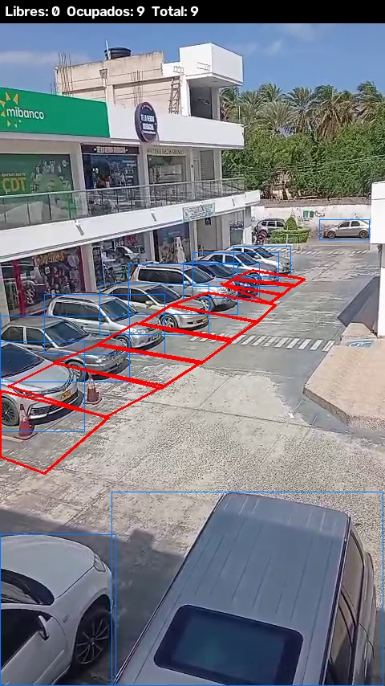

# Parqueadero inteligente – Talatshii Outlet Plaza

Proyecto final de **Visión Artificial** (Ingeniería de Sistemas, Universidad de La Guajira). Proyecto 6.

**Integrantes:** Sebastián Ramos y Daniela Sáenz · **Docente:** Eduardo Sierra Fragozo

Sistema que indica **cuántos cupos hay libres y cuáles**, a partir de una cámara fija en un punto alto. Detecta los
vehículos con YOLO, decide la ocupación de cada cupo, suaviza el estado en el tiempo y guarda los cambios en una
base de datos SQLite.

> **Estado: avance 2 (17 de noviembre de 2026).** Sistema de punta a punta funcionando, con base de datos y primeras
> métricas. Falta el tablero (Streamlit), la estabilización de la cámara y la comparación con una CNN por cupo
> (ver [Plan](#plan-de-la-semana-3)).

## Cliente

| | |
|---|---|
| Empresa | Talatshii Outlet Plaza, centro comercial abierto en Riohacha, La Guajira |
| Usuarios | El administrador (tablero y reportes) y el vigilante de la entrada (cupos libres en pantalla) |
| Problema | No hay forma de saber cuántos cupos quedan sin entrar a mirar; el vigilante cuenta a ojo y no hay datos de ocupación por hora |
| Indicador de éxito | Bajar la búsqueda de cupo de unos 4 min a menos de 2 · exactitud por cupo mayor al 90 % · tablero con retraso máximo de 5 s y sin parpadeos |

## Cómo funciona

```
video o cámara → recorte de la zona → YOLO11n (carro, moto, bus, camión) → cobertura vehículo/cupo
              → suavizado temporal → SQLite → video anotado con el conteo de cupos
```

1. **Cupos como polígonos.** Cada cupo se dibuja con clics sobre un fotograma de referencia y se guarda en JSON.
2. **Detección.** YOLO11n preentrenado en COCO (sin reentrenar), clases 2, 3, 5 y 7.
3. **Ocupación.** Un cupo está ocupado si algún vehículo cubre al menos el **30 %** del área del cupo
   (`--umbral 0.30`). Se usa cobertura sobre el cupo y no el punto inferior del carro, porque con la cámara alta
   las cajas incluyen techo y costado.
4. **Suavizado.** El estado de un cupo solo cambia si la nueva lectura se mantiene **5 decisiones seguidas**
   (`--estable 5`), para evitar parpadeos.
5. **Base de datos.** Se guarda un registro solo cuando un cupo cambia de estado, más una serie de tiempo con el
   total de libres y ocupados.

Técnicas del curso que aparecen: YOLO (CNN), modelo de cámara y perspectiva (polígonos sobre la imagen),
operaciones aritméticas sobre imágenes (máscaras `fillPoly` y conteo de píxeles) y umbrales.

## Estructura del repositorio

```
parqueadero-inteligente/
├── README.md
├── requirements.txt
├── db/
│   └── schema.sql                 modelo de la base de datos
├── src/
│   ├── parqueadero_sistema.py     sistema completo (detección, cupos, suavizado, BD, video, métricas)
│   ├── etiquetar_gt.py            herramienta para etiquetar la ocupación real y medir métricas
│   ├── reporte_db.py              consultas de ejemplo sobre la base de datos
│   ├── herramientas/              definir_plazas, validar_plazas, recortar_zona, test_camera
│   └── prototipos/                scripts de la semana 1 (se conservan como historial)
├── data/
│   ├── talatshii/                 datos propios (ver su README)
│   └── camara_publica/            cámara pública de YouTube: 21 cupos y capturas
├── results/                       resultado final de la corrida sobre el video propio
├── models/                        el modelo se descarga solo (ver su README)
└── docs/                          informe y enlaces
```

## Instalación

Requiere Python 3.10 o superior.

```bash
python -m venv .venv
source .venv/bin/activate        # en Windows: .venv\Scripts\activate
pip install -r requirements.txt
```

La primera ejecución descarga `yolo11n.pt` automáticamente. Todos los comandos se ejecutan **desde la raíz del repositorio**.

## Uso

### 1. Sobre un video propio

```bash
# a) Sacar un fotograma de referencia (guarda data/talatshii/zona_parqueadero.jpg)
python src/parqueadero_sistema.py --fuente video.mp4 --ref-frame 100

# b) Dibujar los cupos con clics: C cierra un cupo, U deshace, S guarda, Q sale
python src/herramientas/definir_plazas.py --imagen data/talatshii/zona_parqueadero.jpg --plazas data/talatshii/plazas.json

# c) (opcional) Validar que los polígonos quedaron bien
python src/herramientas/validar_plazas.py --imagen data/talatshii/zona_parqueadero.jpg --plazas data/talatshii/plazas.json

# d) Correr el sistema completo
python src/parqueadero_sistema.py --fuente video.mp4
```

Salidas: `db/parqueadero.db`, `results/resultado.mp4` y `results/resultado_final.jpg`. Al final la consola muestra el
estado del parqueadero, los cambios confirmados y los FPS de análisis.

### 2. Sobre la cámara pública en vivo (YouTube)

```bash
python src/parqueadero_sistema.py \
  --fuente https://youtu.be/gQUoJ6inXK4 \
  --roi 305,85,570,235 \
  --plazas data/camara_publica/plazas.json
```

Los 21 cupos de `data/camara_publica/plazas.json` se dibujaron sobre un recorte que empieza en `x=305`, por eso el
`--roi` debe ser exactamente `305,85,570,235`. **Cada escena necesita su propio `plazas.json`**: usar el de una
escena en otra produce lecturas absurdas (por ejemplo, todos los cupos libres con carros visibles). Se detiene con `Q`.

### 3. Medir métricas

```bash
# Exportar 12 fotogramas de prueba equidistantes
python src/parqueadero_sistema.py --fuente video.mp4 --exportar 12

# Etiquetar a mano: clic en un cupo alterna libre/ocupado, N siguiente, Q guardar y salir
python src/etiquetar_gt.py

# Correr el sistema comparando contra las etiquetas
python src/parqueadero_sistema.py --fuente video.mp4 --gt data/talatshii/gt.json
```

Se etiqueta según el cupo **físico** al que corresponde cada polígono, aunque la cámara se haya movido; así el
desfase cuenta como error del sistema. Se imprimen exactitud, precisión y recall con y sin suavizado.

### 4. Consultar la base de datos

```bash
python src/reporte_db.py
```

O directamente con SQL:

```sql
-- Cupos libres ahora
SELECT COUNT(*) FROM estados
WHERE id IN (SELECT MAX(id) FROM estados GROUP BY cupo_id) AND ocupado = 0;

-- Ocupación promedio por hora
SELECT strftime('%H', momento) AS hora,
       ROUND(AVG(ocupados * 1.0 / (libres + ocupados)), 2) AS ocupacion
FROM resumen GROUP BY hora;
```

### Parámetros principales

| Parámetro | Por defecto | Qué hace |
|---|---|---|
| `--conf` | 0.35 | Confianza mínima de YOLO |
| `--imgsz` | 960 | Tamaño de entrada de YOLO |
| `--umbral` | 0.30 | Cobertura mínima vehículo/cupo para marcar ocupado |
| `--estable` | 5 | Decisiones seguidas para confirmar un cambio de estado |
| `--salto` | 3 | Analiza 1 de cada N fotogramas |
| `--roi` | ninguno | Recorte `x1,y1,x2,y2` de la zona de análisis |

## Resultados

Prueba sobre el video propio (Talatshii, 32 s, 9 cupos): **12 fotogramas etiquetados a mano, 108 decisiones de cupo**.
YOLO es preentrenado y no se reentrenó, así que los fotogramas de prueba no se usaron para ajustar el modelo.

| Confianza | Variante | Exactitud | Precisión | Recall | F1 | FPS de análisis |
|---|---|---|---|---|---|---|
| 0.25 | Sin suavizado | 0.806 | 0.827 | 0.886 | 0.855 | 2.8 |
| 0.25 | Con suavizado | 0.815 | 0.829 | 0.900 | 0.863 | 2.8 |
| 0.35 | Sin suavizado | 0.787 | 0.822 | 0.857 | 0.839 | 3.4 |
| 0.35 | Con suavizado | 0.796 | 0.824 | 0.871 | 0.847 | 3.4 |
| 0.50 | Sin suavizado | 0.778 | 0.819 | 0.843 | 0.831 | 2.9 |
| 0.50 | Con suavizado | 0.778 | 0.819 | 0.843 | 0.831 | 2.9 |

Conteos (TP / TN / FP / FN) a 0.35: 60 / 25 / 13 / 10 sin suavizado y 61 / 25 / 13 / 9 con suavizado.

- **Ninguna configuración llega al 90 %** de exactitud que se fijó como indicador de éxito.
- La confianza de YOLO solo mueve los falsos negativos (de 11 a 8 al bajar de 0.50 a 0.25). Los falsos positivos (13) y
  los verdaderos negativos (25) no cambian con ningún valor: el error principal no viene del detector sino de los cupos.
- El suavizado mejora poco porque el desfase de los polígonos dura varios cuadros seguidos.



## Casos de falla conocidos

1. **Cámara en mano.** El video se grabó sin trípode y el encuadre se mueve; los polígonos son fijos y dejan de cubrir
   los cupos. El contador oscila entre 0 y 9 libres con la fila de carros estacionada.
2. **Poca altura de cámara.** Los vehículos se ven de lado y se tapan entre sí; las cajas incluyen techo y costado y
   se solapan con los cupos vecinos.
3. **Vehículos en tránsito.** Carros que cruzan o maniobran generan ocupaciones momentáneas.
4. **Archivo de cupos equivocado.** Usar el `plazas.json` de una escena en otra deja todos los cupos libres.
5. **Cámara pública nocturna.** Menos contraste y sombras largas.

## Plan de la semana 3

- [ ] Estabilizar la imagen: ORB + homografía contra un fotograma de referencia, y mover los polígonos con ella.
- [ ] Tablero en Streamlit que lee `db/parqueadero.db` (mapa coloreado y cupos libres).
- [ ] Reto extra: comparar detección (YOLO) contra clasificación por cupo (CNN binaria con MobileNetV2).
- [ ] Medir los cuadros por segundo en vivo.
- [ ] Clasificar los 13 falsos positivos por causa (cámara movida, carro vecino, sombra).

## Datos y evidencias

- **Videos propios, videos de resultado y evidencias:** [ENLACE A LA CARPETA DE DRIVE]
- **Video demo (máx. 5 min):** [ENLACE]
- **Informe del avance 2:** [ENLACE]

Los videos no están en el repositorio porque pesan decenas de MB y muestran placas y personas.

## Créditos y fuentes

- Cámara pública usada para desarrollar el prototipo: transmisión en vivo de la plaza Riegrovo nám. (YouTube,
  <https://youtu.be/gQUoJ6inXK4>), con zonas pixeladas en origen. **No cuenta como dataset propio.**
- Modelo: [Ultralytics YOLO11](https://docs.ultralytics.com/) (licencia AGPL-3.0), preentrenado en COCO.
- Procesamiento de imagen: OpenCV y NumPy.
